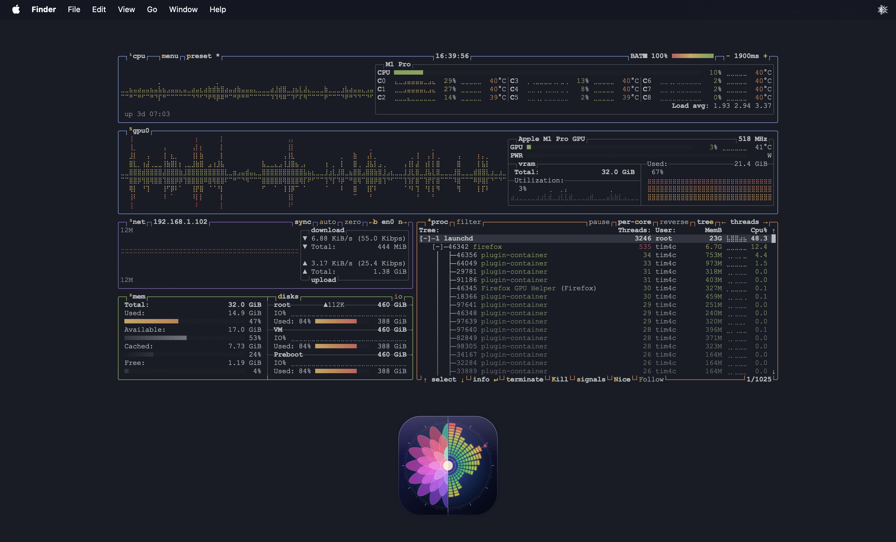

# Btop Desktop

**The real btop system monitor, integrated into your macOS desktop.**

Btop Desktop displays CPU, memory, disks, network activity, and processes in a transparent desktop
panel. It combines btop's terminal interface with native macOS Settings and a menu bar app. The
assembled application includes its runtime; Homebrew is not needed to run it.

Personal project under active development. You can build from source on the supported macOS
environment. Experimental downloads, when available, are listed on the
[releases page](https://github.com/Tim4c/BtopDesktop/releases); they are signed ad hoc and not
notarized by Apple. macOS may block their first launch; follow the release's installation notes.



## Features

- Wallpaper mode for passive monitoring, with clicks passing through to the desktop.
- Interactive mode for btop's mouse, scrolling, keyboard controls, and menus.
- Adjustable size, position, font, opacity, borders, rounded corners, and grayscale.
- Separate focused and unfocused appearances, plus bundled and imported themes.
- Desktop-icon visibility controls and blur during Mission Control/App Exposé.
- Persistent presentation preferences and an isolated btop configuration.

## Requirements

**macOS 27 or later and Apple Silicon (ARM64).** The bundled btop binary also requires this
environment. The project currently builds and signs the app locally; it provides no notarized
release, installer, or automatic updates.

The personal Homebrew tap is being prepared. See
[Community prereleases and Homebrew](docs/releases.md) for the release process and current
installation limitations.

Accessibility access enables focused Escape handling and overview-state detection. See
[Getting started](docs/getting-started.md) for permission details.

## Quick start

If you already have an assembled `BtopDesktop.app`:

1. Open the application and find the chart icon in the menu bar; there is no Dock icon.
2. Open **Settings** to adjust the panel's appearance, size, position, and theme.
3. Enable **Enable interactive mode**, then click inside btop to give it focus.
4. Disable interactive mode to return to passive desktop monitoring.
5. Choose **Quit** from the menu bar to close the app and let btop save its options.

To build from a checkout, install Xcode and its command-line tools with Swift 6 support. Install
Apple's Metal Toolchain component once for the selected Xcode installation:

```sh
xcodebuild -downloadComponent MetalToolchain
```

Then run from the repository root:

```sh
scripts/install-vendor.zsh
scripts/build-app.zsh
open BtopDesktop.app
```

Quit the running app before rebuilding. See [Development and building](docs/development.md) for
toolchain setup, stable local signing, and dependency verification.

## Documentation

The [documentation index](docs/index.md) contains the complete guides.

| For users                                         | For developers                                                |
| ------------------------------------------------- | ------------------------------------------------------------- |
| [Getting started](docs/getting-started.md)        | [Development and building](docs/development.md)               |
| [User guide](docs/user-guide.md)                  | [Architecture](docs/architecture.md)                          |
| [Configuration and themes](docs/configuration.md) | [Overview state and fixed blur](docs/overview-transitions.md) |
| [Troubleshooting](docs/troubleshooting.md)        | [Testing and validation](docs/testing.md)                     |

btop supplies monitoring and terminal commands; Btop Desktop handles desktop integration and
presentation. Embedded component licenses and the current distribution setup are documented in
[Dependencies and distribution](docs/dependencies.md).

## Contributing

Bug reports, documentation improvements, and focused pull requests are welcome. For bugs, include
your macOS version, Mac model, steps to reproduce, and expected versus actual behavior. Discuss
larger changes in an issue before starting implementation.

See [Contributing](CONTRIBUTING.md) for development setup and checks to run before submitting a pull
request.

## License

Btop Desktop's original source code and documentation are licensed under the [MIT License](LICENSE).

Third-party components retain their own licenses, including btop (Apache-2.0) and SwiftTerm (MIT).
See [Dependencies and distribution](docs/dependencies.md) for details.

## Credits

- [btop](https://github.com/aristocratos/btop) provides the system monitor and themes.
- [SwiftTerm](https://github.com/migueldeicaza/SwiftTerm) provides the native terminal view.
- [SwiftLint](https://github.com/realm/SwiftLint) provides development lint checks through
  [SwiftLintPlugins](https://github.com/SimplyDanny/SwiftLintPlugins).
