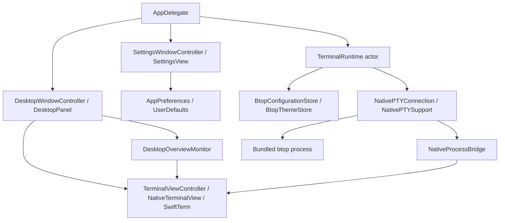

# Architecture

[Documentation index](index.md) · [Project home](../README.md)

## Component boundaries

Btop Desktop embeds the real btop process in an AppKit desktop panel. btop owns monitoring
data and its terminal interface. SwiftTerm owns terminal emulation and drawing. The app owns
the panel, focus rules, Settings, preferences, local configuration, and process lifecycle.
There is no HTTP server or browser view.

| Owner | Responsibility | Source |
| --- | --- | --- |
| `AppDelegate` | Menu bar, startup, Settings callbacks, theme orchestration, deferred app termination | [AppDelegate.swift](../Sources/BtopDesktop/App/AppDelegate.swift) |
| `DesktopWindowController` | Screen selection, panel geometry, appearance and monitor wiring | [DesktopWindowController.swift](../Sources/BtopDesktop/App/DesktopWindowController.swift) |
| `DesktopPanel` | Explicit click focus, desktop interaction, Escape receiver | [DesktopPanel.swift](../Sources/BtopDesktop/App/DesktopPanel.swift) |
| `DesktopAppearanceState` | Mode, preview, resize, and active/inactive appearance decisions | [DesktopAppearanceState.swift](../Sources/BtopDesktop/App/DesktopAppearanceState.swift) |
| `TerminalViewController` | SwiftTerm setup, output delivery, reveal readiness, resize, and layer filters | [TerminalViewController.swift](../Sources/BtopDesktop/UI/TerminalViewController.swift) |
| `TerminalRuntime` | Actor-isolated process lifecycle, environment, bounded shutdown, and theme restart | [TerminalRuntime.swift](../Sources/BtopDesktop/Infrastructure/TerminalRuntime.swift) |
| `NativePTYConnection` | Serial descriptor I/O, buffered input, child exit monitoring | [NativePTYConnection.swift](../Sources/BtopDesktop/Infrastructure/NativePTYConnection.swift) |
| `NativeProcessBridge` | Locked output buffering, terminal size, and termination callback | [NativeProcessBridge.swift](../Sources/BtopDesktop/Infrastructure/NativeProcessBridge.swift) |
| `SettingsWindowController` | Translate Settings events into persistence and application callbacks | [SettingsWindowController.swift](../Sources/BtopDesktop/UI/SettingsWindowController.swift) |

## Startup and terminal I/O

`AppDelegate` selects accessory activation policy and creates the menu bar item. It then reads
Finder icon visibility asynchronously and starts `TerminalRuntime`, shows its returned
`TerminalEndpoint`, then applies the persisted display mode.

The runtime locates `Resources/bin/btop` and `Resources/themes`, prepares the isolated
configuration, and creates a `NativePTYConnection`. The C target uses a PTY and resets
inherited signal state before executing the child. btop receives its configuration path
and bundled theme directory as command-line arguments.

The child inherits the environment with `DYLD_LIBRARY_PATH` and `DYLD_FALLBACK_LIBRARY_PATH`
removed. The runtime sets `TERM=xterm-256color`, `COLORTERM=truecolor`, and application-local
`XDG_CONFIG_HOME` and `XDG_STATE_HOME` values.

PTY reads run on a serial I/O queue. The bridge buffers output until a sink is attached.
The controller schedules delivery in the main run loop's common modes and feeds bytes into
SwiftTerm. A generation number rejects output from a replaced session. Keyboard input flows
from SwiftTerm's delegate to the runtime actor and then the PTY's pending-input buffer;
partial writes and `EAGAIN` are handled by the write dispatch source. Terminal grid changes
update the bridge's window size and apply it to the PTY.

## Concurrency and lifetime rules

AppKit controllers are main-actor isolated. `TerminalRuntime` is an actor; descriptor I/O is
owned by a serial queue. `NativeProcessBridge` protects shared state with `NSLock`.
The two bridge/connection classes declare `@unchecked Sendable`, so changes must preserve
their locking and queue ownership. Bridge sink callbacks run while its lock is held: keep
them short and avoid synchronously re-entering the bridge.

`DesktopIconVisibilityController` is a separate actor. It serializes Finder preference reads,
writes, restarts, and error recovery off the main actor. A failed Finder restart restores
the prior preference, or deletes the key if it was absent. The application re-reads the state
on failure; revision checks prevent older reads from overwriting a newer change. Settings
and menu callbacks await completion while the icon controls are disabled.

Use common run-loop modes for UI delivery that must survive AppKit event-tracking loops.
Keep process waits off the main thread. Cancel stale reveal/timeout work and invalidate
timers when their owner ends.

## Loading and reveal

A new endpoint hides the terminal behind `SplashView` and clears prior readiness state.
Reveal requires a display update, nonempty terminal content, and no active synchronized
output frame. It can proceed after observed synchronized output, after 80 ms of quiet output,
or after one second from the first output once the other conditions hold. The controller
renders a cached bitmap before revealing; stale completion handlers are generation-guarded.

## Desktop placement and focus

At startup, the panel uses the screen containing the pointer, falling back to the main
screen. Its dimensions are proportions of the screen's visible frame. Later geometry
updates select the screen with the greatest intersection with the panel, falling back to
the main screen. The panel joins Spaces and is stationary with full-screen auxiliary behavior.
These flags still need testing on physical displays.

Wallpaper mode ignores mouse events and sits one level below desktop icons. Interactive mode
sits one level above them. Switching mode clears click focus; enabling interaction never
activates the terminal by itself. A terminal click activates the app, makes the panel key,
and sets the terminal as first responder. Active appearance requires interactive mode,
explicit click focus, and a key panel, unless a Settings preview overrides it.

`TerminalEscapeFilter` consumes unmodified Escape only when the panel supplies a focused
terminal receiver. It delivers one press/release pair directly to the responder and consumes
the release even if focus changes after the captured press. Modified shortcuts and input
outside this focus retain normal behavior.

## Appearance and Settings

`AppPreferences` validates persisted numeric ranges, colors, and anchors. `PanelPreferences`
defines the presentation defaults. Settings callbacks update persistence, apply layout,
and manage temporary previews. Theme preview bypasses grayscale; appearance preview selects
the previewed active/inactive state; a manual resize or corner-radius preview can show a guide.
Automatic display reflow does not add a resize guide. Settings opening/closing clears click focus.

## Overview blur

`DesktopOverviewMonitor` polls Dock Accessibility state every 150 ms without overlapping reads.
`DesktopWindowController` forwards confirmed states to `TerminalViewController`, which immediately
sets blur radius 3 for Mission Control/App Exposé and removes blur for Desktop/Show Desktop.
There is no gesture tracking or animation clock. Grayscale remains independent of blur.
See [Overview state and fixed blur](overview-transitions.md) for detection limits and validation.

## Shutdown and theme replacement

Normal stop suppresses the child-exit callback, sends `SIGINT`, and waits up to three seconds.
If still running, it sends `SIGKILL` and waits up to one more second. Concurrent stop requests
share the same task. Successful child exit is required before applying a theme change.

App termination returns `.terminateLater`. Shutdown runs outside the main actor and the
termination reply is delivered through the main run loop, preventing the nested AppKit
termination loop from blocking process cleanup. An ordinary, unsolicited btop exit terminates
the app. Controlled theme restarts suppress that callback and reuse the desktop panel.

Theme selection validates the candidate, checks configuration saving, stops the child,
writes the selected theme only after a graceful exit, and starts a replacement endpoint.
On failure, the app ends the preview and attempts runtime recovery unless app termination
has begun. See [Configuration](configuration.md) for storage and [Testing](testing.md) for coverage.
