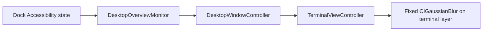

# Overview state and fixed blur

[Documentation index](index.md) · [Project home](../README.md)

The terminal uses a fixed blur while Mission Control or App Exposé is detected.
The blur changes immediately when a confirmed system state arrives. There is no gesture
progress tracking, prediction, interpolation, animation timer, or display link.

## Detection and rendering

`DesktopOverviewMonitor` polls every 150 ms in common run-loop modes. Reads run in a detached
utility task and never overlap. The Dock root has a 50 ms Accessibility messaging timeout.
The monitor requires Accessibility access and inspects the Dock's Accessibility children.

The observed identifiers are `mc` for Mission Control, `appexpose` for App Exposé, and
`showdesktop` for Show Desktop. Show Desktop takes precedence. These identifiers are observed
platform behavior, not a guaranteed API. A missing Dock or missing Accessibility access
produces desktop state; three failed Accessibility reads also fall back to desktop state.

## Fixed states

| Detected state | Terminal blur radius |
| --- | --- |
| Desktop | 0; blur filter removed |
| Mission Control | 3 |
| App Exposé | 3 |
| Show Desktop | 0; blur filter removed |

`TerminalViewController` applies the fixed radius with implicit Core Animation actions disabled.
Repeated states do not reapply filters. The optional `CIColorMatrix` grayscale filter remains
independent of the named `CIGaussianBlur` filter, `overviewBlur`. Removing blur preserves grayscale.
The current blur is preserved when a theme change replaces the terminal endpoint.

There is no global Dock gesture event tap or native gesture target. Trackpad and keyboard
activation use the same confirmed-state path, independently of terminal focus and view visibility.

## Detection latency and manual validation

The visual change is immediate after detection, not necessarily at the start of the system gesture.
Polling, Accessibility reads, and main-thread scheduling can introduce a short delay. A cancelled
or very brief overview may finish between polls. There is no predicted state to undo afterward.

Check opening and closing Mission Control and App Exposé, Show Desktop, and repeated transitions
with both keyboard and trackpad. Repeat in Wallpaper and Interactive modes, with grayscale enabled
and disabled, and on each available display. Verify that returning to the desktop removes blur.
Without Accessibility access the panel should stay sharp.

Automated tests cover fixed radii, immediate removal, hidden-terminal updates, grayscale
composition, repeated state changes, and preservation across endpoint attachment. Physical Spaces
and overview behavior still require manual validation on the supported macOS version.

Sources: [state monitor](../Sources/BtopDesktop/Infrastructure/DesktopOverviewMonitor.swift),
[state decoding](../Sources/BtopDesktop/Infrastructure/DesktopOverviewState.swift),
[panel wiring](../Sources/BtopDesktop/App/DesktopWindowController.swift), and
[filter application](../Sources/BtopDesktop/UI/TerminalViewController.swift).
